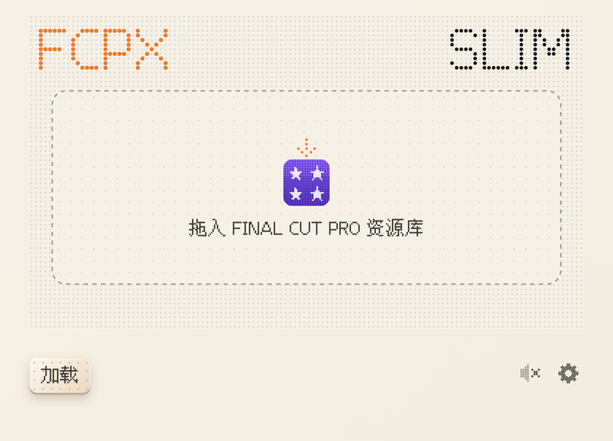
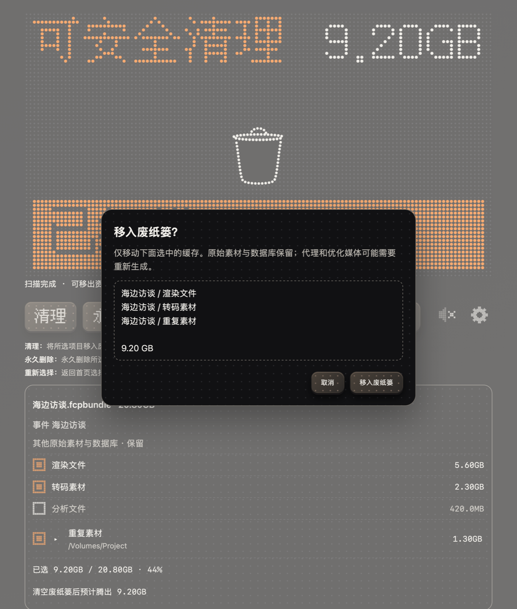

#  FCPX Slim

## [⬇ 下载 FCPX Slim 0.9.6](https://github.com/SkyyyyLiu/FCPX-Slim/releases/download/v0.9.6/FCPX-Slim-0.9.6-arm64.zip)

**Apple 芯片版 ZIP · macOS 14 或更新版本 · 公开预览版**

[首次打开说明](INSTALL.md) · [版本发布页与 SHA-256 校验](https://github.com/SkyyyyLiu/FCPX-Slim/releases/tag/v0.9.6)

FCPX Slim 是胡子盖制作的 Final Cut Pro 资源库瘦身工具。界面采用暖纸色底、圆点组成的状态屏和带轻微起伏的按键。扫描进度、待处理内容和关键状态用琥珀橙标出，文件分类和容量集中在明细里，方便清理前逐项核对。浅色与深色界面使用同一套点阵和状态颜色。

## 下载与安装

1. 点击上方的 **下载 FCPX Slim 0.9.6**，直接取得 `FCPX-Slim-0.9.6-arm64.zip`。也可以在版本发布页的 **Assets** 找到同名文件。
2. 解压 ZIP，把 `FCPX Slim.app` 拖到「应用程序」，然后从那里双击打开。
3. 预览版使用临时签名，尚未通过 Apple 公证。如果 macOS 提示无法验证开发者，先关闭提示，再到「系统设置」→「隐私与安全性」找到 FCPX Slim，点击「仍要打开」并确认。[查看完整首次打开说明](INSTALL.md)

## 剪辑中能解决什么

- **剪到一半，资源库越来越大。** 渲染文件、优化媒体和代理媒体会随剪辑积累。把 `.fcpbundle` 拖进来，FCPX Slim 会先只读扫描，列出各类文件占用和选中项目预计可移出的容量。
- **同一批源素材占了两份空间。** 只有在库外找到唯一且内容一致的副本时，库内重复素材才列为可处理项。清理时可把库内副本改为指向库外原件，分析文件和其他原始素材保留。
- **腾空间前想先确认，清理后还能反悔。** 展开「明细」逐项勾选。常规清理先移到废纸篓，可在 App 里撤销。需要立即释放空间时，可单独确认永久删除。执行清理或恢复前请退出 Final Cut Pro。
- **一个工程文件夹里有多个资源库。** 可以加载整个工程文件夹，选中要扫描的资源库，处理完再用「导入 FCP」打开所选资源库。

所有扫描和清理都在 Mac 本机执行。

## 界面截图

以下为 v0.9.6 界面，使用示例资源库。

**载入资源库**



**扫描结果与明细**


**确认移入废纸篓**



## 视频演示

### 资源库为什么会膨胀

这段动画用逐渐鼓起的资源库图标，说明剪辑过程中生成的文件如何一点点累积。

https://github.com/user-attachments/assets/ad6aaca0-d3e5-44d2-a91a-49192c243311

### 从扫描到清理，再撤销

这段演示展示如何拖入资源库、查看扫描结果与清理选项，以及清理之后如何恢复。

https://github.com/user-attachments/assets/76d8dcba-9693-41c0-b897-e550ad40a4c4

## 从源码构建

安装 Apple Command Line Tools 后，在仓库目录运行：

```sh
zsh build.sh
zsh test.sh
```

构建产物位于 `build/FCPX Slim.app`，使用本地临时签名。测试中的「导入 FCP」集成检查需要本机安装 Final Cut Pro。

页脚的作者链接使用系统浏览器或邮件应用打开。点阵字形来源见[第三方素材声明](THIRD_PARTY_NOTICES.md)。
